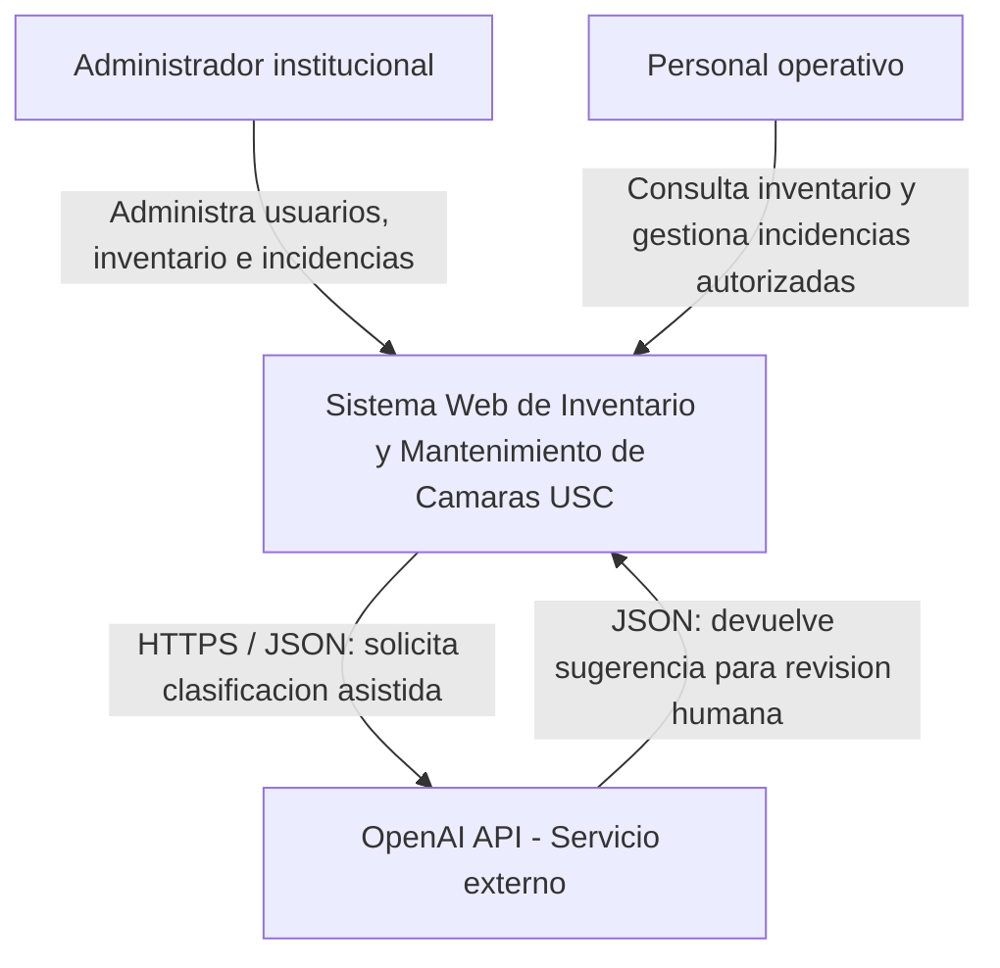
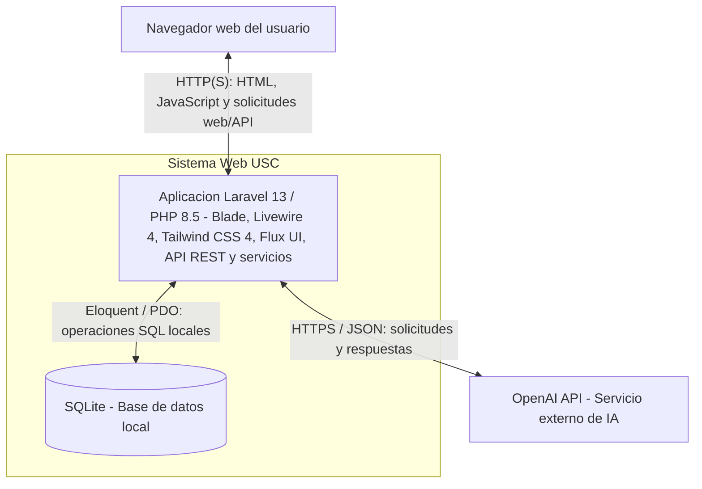

# Arquitectura del Sistema Web de Inventario y Mantenimiento de Cámaras de Seguridad

## 1. Descripción general

El sistema web de la Universidad Santiago de Cali (USC) permite administrar el inventario de cámaras de seguridad, usuarios e incidencias.

Su arquitectura se basa en una aplicación monolítica desarrollada en PHP 8.5 y Laravel 13, con interfaces Blade y Livewire 4, servicios de negocio, API REST y persistencia SQLite.

El sistema incorpora una integración con OpenAI API para sugerir clasificaciones de incidencias, sujetas a revisión y confirmación humana.

## 2. Modelo C4 - Nivel 1: Contexto

El diagrama representa a los usuarios institucionales, el sistema principal y el servicio externo de inteligencia artificial.

### Actores y sistemas externos

- **Administrador institucional:** gestiona usuarios, permisos e información autorizada.
- **Personal operativo:** consulta el inventario y gestiona las incidencias permitidas por su rol.
- **Sistema web USC:** centraliza la información y los procesos del MVP.
- **OpenAI API:** ofrece sugerencias de clasificación de incidencias cuando el servicio está disponible.

## 3. Modelo C4 - Nivel 2: Contenedores

El sistema utiliza una arquitectura monolítica. La presentación, las rutas API y los servicios de negocio forman parte de una misma aplicación Laravel.

SQLite almacena los datos localmente. OpenAI es un servicio externo.

### Tecnologías principales

| Elemento | Tecnología | Responsabilidad |
|---|---|---|
| Interfaz web | Blade, Livewire 4, Tailwind CSS 4 y Flux UI | Interacción con usuarios |
| Backend | PHP 8.5 y Laravel 13 | Reglas de negocio y API REST |
| Persistencia | SQLite y Eloquent | Almacenamiento y consultas |
| Autorización | Policies y middleware de Laravel | Control de acceso |
| Inteligencia artificial | OpenAI API | Sugerencias de clasificación |
| Entorno de desarrollo | Laravel Herd | Ejecución local |
| Contenedorización | Dockerfile y Docker Compose | Configuración de ejecución en contenedores |

La existencia de Dockerfile y Docker Compose no implica por sí sola que el despliegue en contenedores esté activo. Esa configuración debe verificarse por separado.

## 4. Correspondencia con el código

| Elemento arquitectónico | Evidencia del proyecto |
|---|---|
| Interfaz Livewire | app/Livewire/ |
| Controladores API | app/Http/Controllers/Api/ |
| Servicios de aplicación | app/Services/ |
| Entidades de dominio y persistencia | app/Models/ |
| Reglas de autorización | app/Policies/ |
| Contrato de clasificación | app/Contracts/IClasificadorIncidencias.php |
| Adaptador OpenAI | app/Infrastructure/AI/OpenAIIncidentClassifier.php |
| Configuración IA | config/ai.php |
| Rutas web y API | routes/web.php y routes/api.php |
| Configuración de base de datos | config/database.php |

## 5. Verificación y corrección arquitectónica

Se contrastaron los diagramas propuestos con la estructura de carpetas y la configuración activa del proyecto.

**Corrección identificada:** se evitó representar frontend y backend como dos servicios independientes. Ambos pertenecen a una aplicación monolítica Laravel, aunque contienen responsabilidades internas diferenciadas.

**Verificación de persistencia:** el comando `php artisan tinker --execute="echo config('database.default');"` confirmó que la conexión predeterminada es `sqlite`.

La integración de OpenAI se representa como una dependencia externa debido a la existencia del contrato de clasificación, su adaptador y configuración específica. Su disponibilidad operativa depende de la configuración y del proveedor.

## 6. Decisiones de arquitectura

Las decisiones técnicas del MVP se encuentran documentadas mediante registros de decisiones arquitectónicas (ADR).

- [ADR-001: Elección de PHP y Laravel](adr/ADR-001-stack-tecnologico.md)
- [ADR-002: Elección de SQLite](adr/ADR-002-base-datos-sqlite.md)

Los ADR describen el contexto, la decisión adoptada, las alternativas consideradas y sus consecuencias.