# Manual de usuario — Sistema Web de Inventario y Mantenimiento de Cámaras de Seguridad

**Universidad Santiago de Cali — Ciudadela Pampalinda**

**Proyecto:** `gestion-mantenimiento-camaras`  

**Versión:** 1.0  

**Fecha:** 19 de noviembre de 2026  

**Aplicación:** https://usc-camaras-web-production.up.railway.app

> **Alcance:** Este manual explica las operaciones disponibles para usuarios institucionales autorizados. Las opciones visibles dependen de su rol y de los permisos del sistema.

## Ficha del documento

| Campo | Información |
| --- | --- |
| Nombre | Manual de usuario — Sistema Web de Inventario y Mantenimiento de Cámaras de Seguridad |
| Institución | Universidad Santiago de Cali — Ciudadela Pampalinda |
| Proyecto / repositorio | jecaicedotoro-source/gestion-mantenimiento-camaras |
| Rama de desarrollo consultada | codex/consolidacion-mvp-usc (según historial del proyecto) |
| Archivo del manual | `docs/manual-usuario.md` y `docs/img/manual-usuario/` |
| Público objetivo | Personal institucional con credenciales y permisos asignados |

## Contenido

- [1. ¿Qué puedes hacer con el sistema?](#seccion-1)
- [2. Requisitos de acceso y roles](#seccion-2)
- [3. Iniciar sesión y localizar las funciones](#seccion-3)
- [4. Consultar el inventario de cámaras](#seccion-4)
- [5. Registrar una cámara](#seccion-5)
- [6. Retirar una cámara del inventario](#seccion-6)
- [7. Registrar y consultar incidencias](#seccion-7)
- [8. Clasificación asistida por IA y revisión humana](#seccion-8)
- [9. Registrar mantenimiento preventivo o correctivo](#seccion-9)
- [10. Consultar el historial de mantenimientos](#seccion-10)
- [11. Administración de usuarios](#seccion-11)
- [12. Vincular mantenimiento correctivo con una incidencia (HU-12)](#seccion-12)
- [13. Problemas frecuentes y seguridad](#seccion-13)

## 1. ¿Qué puedes hacer con el sistema?

Este sistema permite a personal autorizado consultar y gestionar información administrativa sobre cámaras de seguridad de la Ciudadela Pampalinda. No es una plataforma de visualización de vídeo en directo ni de control remoto de cámaras.

- Consultar el inventario y la identificación de las cámaras registradas.
- Registrar cámaras según los permisos del perfil institucional.
- Registrar incidencias técnicas y documentar fallas detectadas.
- Solicitar, cuando esté habilitada, una sugerencia de clasificación con IA y confirmar o corregir la categoría manualmente.
- Registrar mantenimientos preventivos y correctivos, consultar el historial de una cámara y vincular intervenciones correctivas con incidencias pendientes.
- Gestionar cuentas desde el apartado administrativo, cuando el rol lo autorice.

## 2. Requisitos de acceso y roles

Para operar el sistema se necesita un navegador actualizado, acceso a la dirección web proporcionada por el equipo responsable y una cuenta institucional previamente habilitada. La creación pública de cuentas está desactivada.

| Perfil / condición | Qué debe tener en cuenta el usuario |
| --- | --- |
| Administrador | Gestiona usuarios y cuenta con permisos de operación según las políticas del sistema. |
| Coordinador | Participa en las operaciones de mantenimiento autorizadas para su perfil. |
| Técnico | Puede registrar mantenimientos cuando su cuenta está autorizada; otras acciones dependen de permisos. |
| Auxiliar u otros perfiles | El acceso a consulta y registro varía según políticas y estado de cuenta. |
| Cuenta desactivada o sin permiso | Puede quedar impedida la entrada o la operación solicitada. |

Los permisos se verifican desde el servidor. Si un botón no aparece o una acción devuelve «Acceso denegado», consulta con el administrador.

## 3. Iniciar sesión y localizar las funciones

### 3.1 Entrar al sistema

1. Abre en el navegador la dirección oficial del despliegue que proporcione el administrador. URL final:

   **URL:** https://usc-camaras-web-production.up.railway.app

2. Introduce las credenciales de tu cuenta institucional en el formulario de inicio de sesión. Para acceder a la versión demostrativa, solicita las credenciales al administrador del sistema. Por seguridad, las contraseñas no se publican en este manual.
3. Accede al área de trabajo. Comprueba el nombre del usuario y las opciones de menú que tu perfil tiene habilitadas.
4. Al finalizar, utiliza la opción de cierre de sesión desde el menú de cuenta.

> **Resultado esperado:** El sistema permite acceder a la navegación principal solo con una sesión válida; el menú disponible depende de los permisos.

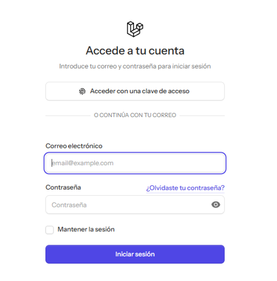

*Figura 1. Pantalla de inicio de sesión.*

### 3.2 Menú principal

La navegación de la aplicación incluye accesos como «Inventario de cámaras», «Registrar cámara», «Incidencias» y «Registrar mantenimiento», cuando el usuario dispone del permiso correspondiente. El apartado «Administración → Usuarios» se reserva a perfiles administrativos.

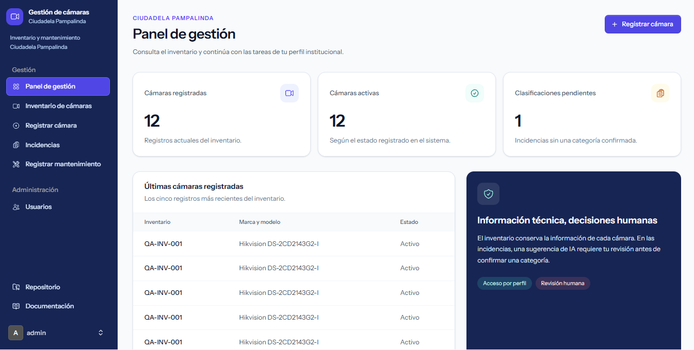

*Figura 2. Navegación principal y opciones visibles.*

## 4. Consultar el inventario de cámaras

**Objetivo:** revisar los equipos registrados y localizar sus datos de identificación, estado y ubicación.

1. Desde la navegación principal, selecciona «Inventario de cámaras».
2. Revisa el listado de equipos. Utiliza las opciones de búsqueda, filtro o paginación que se encuentren disponibles en la pantalla.
3. Identifica la cámara por su código de inventario; comprueba también número de serie, ubicación, marca, modelo y estado cuando aparezcan.

> **Resultado esperado:** La información consultada corresponde a registros del inventario existente; consultar no debe modificar ni duplicar cámaras.

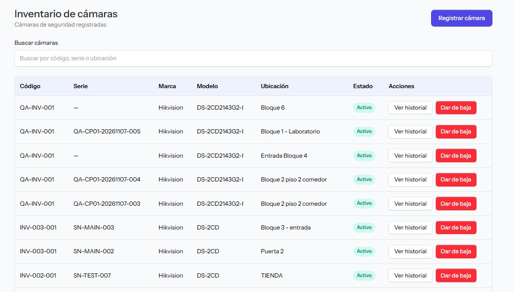

*Figura 3. Listado de inventario de cámaras.*

## 5. Registrar una cámara

**Objetivo:** dar de alta una cámara en el inventario sin perder el control de sus identificadores. Esta operación requiere permisos de registro.

1. Abre «Registrar cámara» desde el menú principal, si tu perfil tiene visible esa opción.
2. Introduce los datos solicitados: código de inventario, marca, modelo, tipo y ubicación. Completa los demás campos habilitados en el formulario.
3. Añade el número de serie únicamente si lo conoces. Si se proporciona, debe ser único; no puede coincidir con el de otra cámara registrada.
4. Revisa, cuando corresponda, la dirección IP, el estado y las observaciones. No incluyas claves de acceso en el campo de observaciones.
5. Pulsa el botón de registro/guardado que muestre el formulario y revisa el mensaje de confirmación.
6. Regresa al inventario y verifica que el registro aparece con los datos indicados.

> **Resultado esperado:** La cámara queda registrada. Es válido que varias cámaras compartan código de inventario; el número de serie, si se informa, debe ser único.

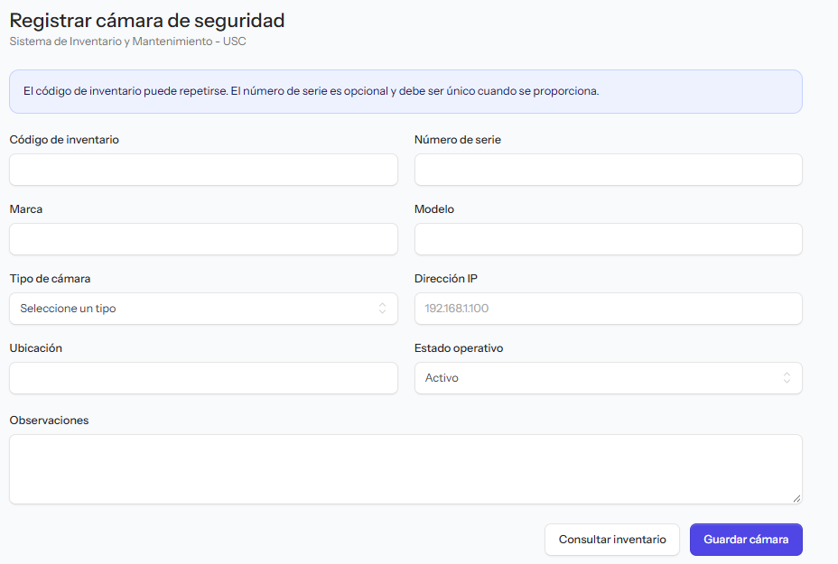

*Figura 4. Formulario de registro de cámara.*

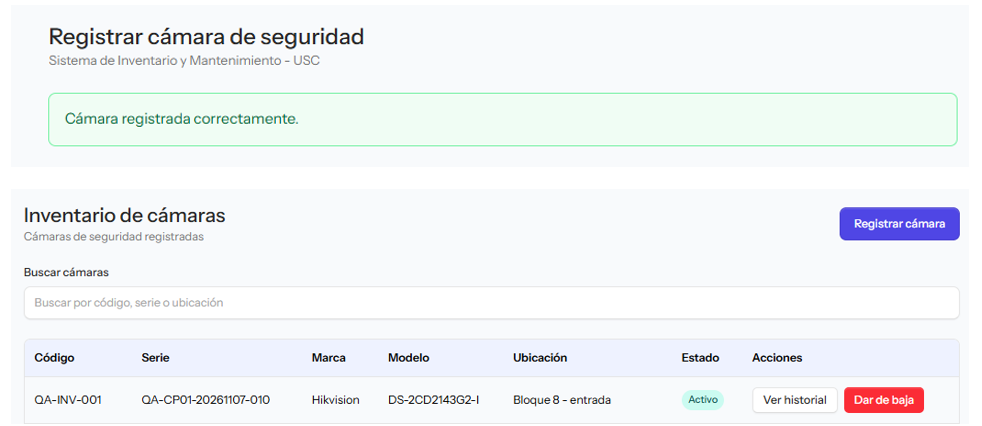

*Figura 5. Confirmación del registro y aparición en inventario.*

**Importante:** si el sistema rechaza el número de serie por duplicado, revisa el dato; no lo sustituyas por uno ficticio para eludir la validación.

## 6. Retirar una cámara del inventario

**Objetivo:** registrar la baja de una cámara cuando la operación esté permitida y mantener trazabilidad de su información histórica.

1. En «Inventario de cámaras», localiza el equipo que se desea retirar.
2. Selecciona la acción de baja o retiro que muestre la interfaz para ese registro; confirma que se trata de la cámara correcta.
3. Lee el mensaje de confirmación e identifica el efecto de la baja antes de aceptarla.
4. Confirma únicamente si estás autorizado y el retiro está justificado. Comprueba el estado del equipo en el inventario después de la operación.

> **Resultado esperado:** Se registra la baja del equipo según las reglas de la aplicación, sin presentar la operación como un borrado físico de todo su historial.

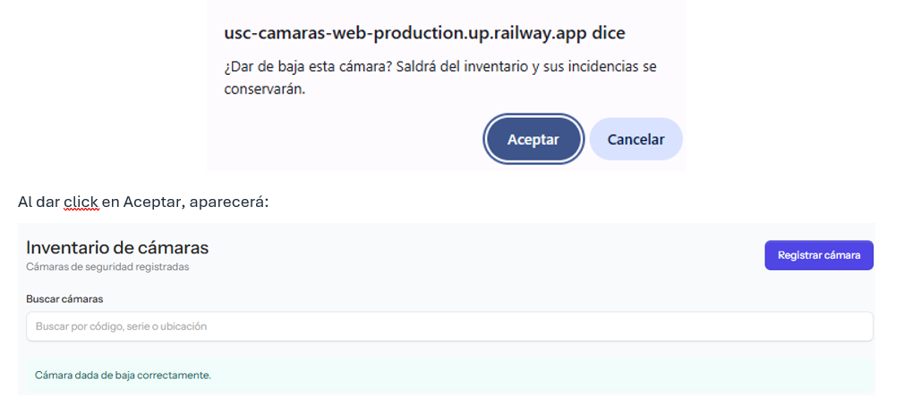

*Figura 6. Confirmación de baja de una cámara.*

## 7. Registrar y consultar incidencias

**Objetivo:** documentar una falla de cámara para su seguimiento técnico y revisión de categoría.

### 7.1 Registrar una incidencia

1. Abre el menú «Incidencias». La pantalla presenta «Incidencias técnicas» y un apartado para «Registrar incidencia».
2. En «Cámara afectada», selecciona el equipo correspondiente.
3. En «Descripción de la falla», escribe el problema observado con datos técnicos suficientes, evitando contraseñas o información innecesaria.
4. Pulsa «Guardar incidencia» y confirma que la nueva incidencia aparece en el listado.

> **Resultado esperado:** La incidencia se guarda y se puede consultar por su número identificador y cámara asociada; la categoría puede permanecer pendiente hasta la revisión.

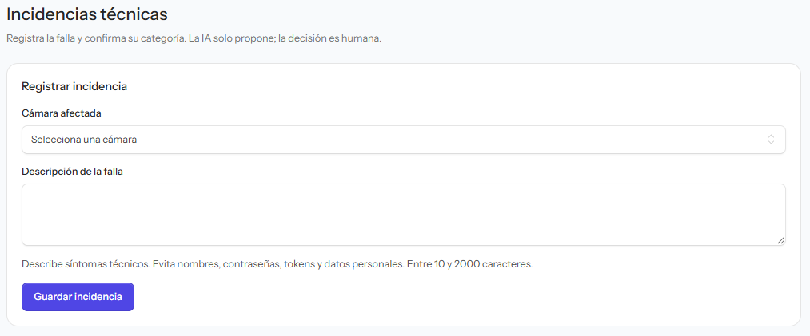

*Figura 7. Formulario de registro de incidencia.*

### 7.2 Revisar incidencias

1. En la misma pantalla, localiza el bloque correspondiente a la incidencia por su identificador y cámara.
2. Revisa la descripción y el indicador de estado de clasificación, por ejemplo, pendiente o confirmado.
3. Si existe una categoría confirmada, verifica que aparezca junto a la información de revisión humana.
4. Para corregir una clasificación pendiente, utiliza la opción de revisión habilitada; no asumas que eliminar incidencias forma parte de la interfaz.

> **Resultado esperado:** Se identifica el estado de la revisión de una incidencia sin modificar su registro por el solo hecho de consultar.

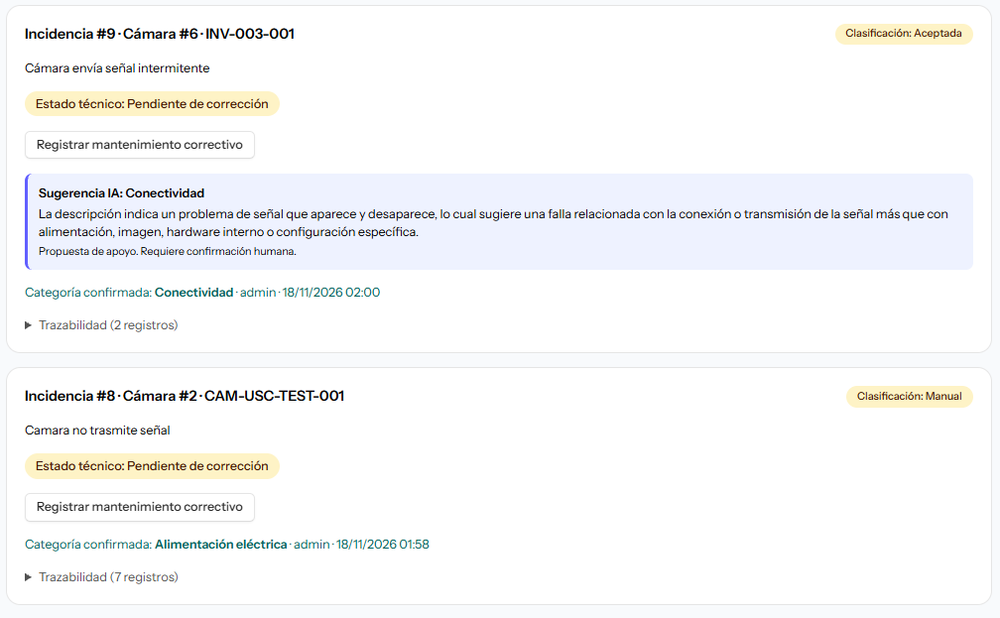

*Figura 8. Listado y estado de las incidencias.*

## 8. Clasificación asistida por IA y revisión humana

La inteligencia artificial propone una categoría a partir de la descripción de la falla. La sugerencia no sustituye la revisión técnica ni confirma que una reparación se haya realizado. La decisión final sobre la categoría corresponde a una persona autorizada.

### 8.1 Solicitar una sugerencia

1. En el listado, localiza una incidencia que esté pendiente de clasificación.
2. Selecciona «Preparar clasificación IA» para revisar el texto que se enviaría al proveedor configurado.
3. Examina el contenido mostrado, incluida cualquier reducción o minimización de datos. No autorices el envío si detectas información sensible que no corresponda compartir.
4. Marca «He revisado el texto y autorizo esta solicitud de clasificación».
5. Pulsa «Clasificar con IA». Espera el resultado de la consulta y revisa la categoría sugerida.

> **Resultado esperado:** Si el servicio responde, la interfaz muestra una sugerencia para revisión. Si no responde, la incidencia sigue pudiendo clasificarse manualmente.

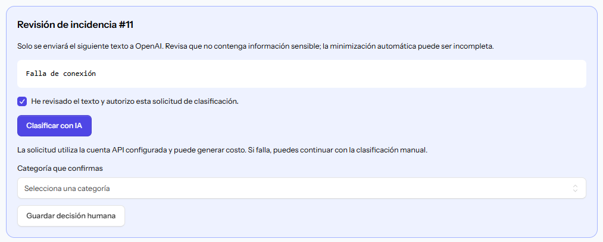

*Figura 9. Preparación y autorización de clasificación IA.*

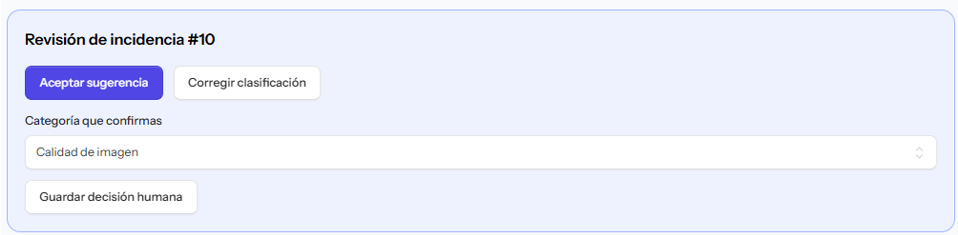

*Figura 10. Resultado de sugerencia de clasificación.*

### 8.2 Confirmar o corregir la categoría

1. Revisa la sugerencia y contrástala con la descripción real de la falla.
2. Si corresponde, selecciona «Aceptar sugerencia».
3. Si no corresponde, pulsa «Corregir clasificación» o utiliza «Clasificación manual» cuando sea necesario.
4. Selecciona «Categoría que confirmas» y pulsa «Guardar decisión humana».
5. Comprueba que la incidencia presenta la categoría confirmada y la información de la revisión.

> **Resultado esperado:** La categoría confirmada se registra como decisión humana diferenciada de la propuesta automática.

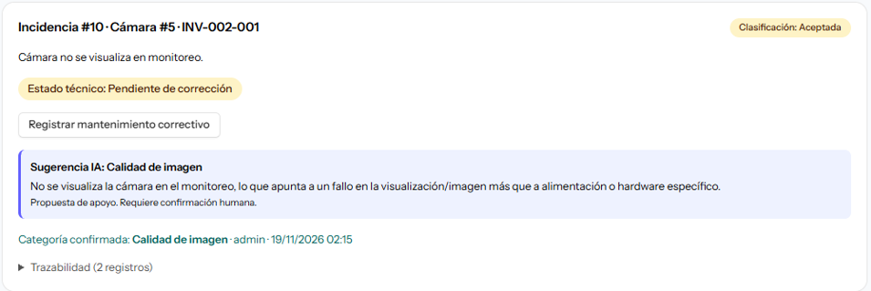

*Figura 11. Registro de decisión humana sobre clasificación.*

### 8.3 Límites de la función de IA

- Puede equivocarse; la sugerencia no demuestra la causa raíz de la avería.
- No opera la cámara ni controla el vídeo. No resuelve automáticamente la incidencia.
- El proveedor se configura en el sistema: OpenAI es la opción predeterminada documentada; Groq existe como alternativa técnica y requiere habilitación explícita.
- Una caída del servicio, una clave de API inválida o problemas de cuota pueden impedir obtener sugerencias. La clasificación manual permanece disponible.
- Enviar un texto de incidencia al proveedor externo exige revisión y autorización expresa del usuario.

## 9. Registrar mantenimiento preventivo o correctivo

**Objetivo:** documentar una intervención realizada sobre una cámara ya existente en el inventario. Solo los roles habilitados pueden efectuar el registro.

1. Selecciona «Registrar mantenimiento» en el menú lateral.
2. En «Cámara intervenida», escoge el equipo del inventario; no crees una segunda cámara para registrar su intervención.
3. Indica «Fecha del mantenimiento».
4. En «Tipo de mantenimiento», selecciona «Preventivo» o «Correctivo» según el trabajo realmente realizado.
5. Completa «Descripción de la intervención», «Responsable del mantenimiento» y «Resultado de la intervención».
6. Revisa la información y pulsa «Guardar mantenimiento».
7. Verifica el mensaje «Mantenimiento registrado correctamente» o el resultado equivalente mostrado por la versión desplegada.

> **Resultado esperado:** La intervención queda relacionada con la cámara seleccionada en el inventario y conservada en el historial de mantenimientos.

**Nota:** una cámara dada de baja no debe admitirse para nuevos registros de mantenimiento, según las validaciones del módulo.

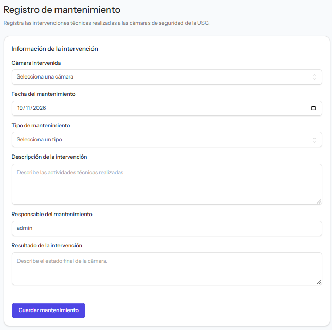

*Figura 12. Formulario de registro de mantenimiento.*

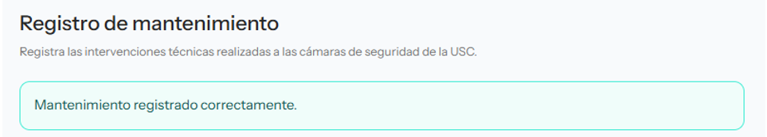

*Figura 13. Confirmación del mantenimiento registrado.*

## 10. Consultar el historial de mantenimientos

**Objetivo:** consultar intervenciones previas asociadas a una cámara y comprobar su trazabilidad.

1. Accede a «Inventario de cámaras» y localiza el equipo deseado.
2. Utiliza la opción que conduce al «Historial de mantenimientos» de esa cámara.
3. Revisa fecha, tipo, descripción, responsable y resultado de cada intervención; cuando exista vinculación HU-12, identifica la incidencia asociada y el resultado de la reparación.
4. Si existen muchos registros, utiliza la paginación disponible.
5. Pulsa «Volver al inventario» para regresar a la lista de cámaras.

> **Resultado esperado:** Se consulta el historial de una cámara sin modificar los registros existentes; pueden conservarse datos históricos de equipos retirados.

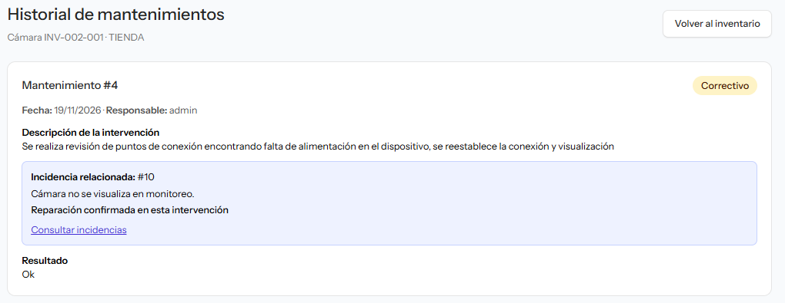

*Figura 14. Historial de mantenimientos por cámara.*

## 11. Administración de usuarios

Las cuentas las crea o gestiona personal autorizado. La interfaz de administración fue validada dentro del proyecto con varias cuentas institucionales.

1. Inicia sesión con una cuenta de administrador.
2. Abre «Administración» y entra en «Usuarios».
3. Localiza la cuenta que deseas consultar o gestionar.
4. Utiliza exclusivamente las acciones disponibles para asignar o comprobar permisos, crear cuentas o cambiar su estado, según la versión desplegada.
5. Confirma el resultado y verifica que el acceso se corresponda con el rol asignado.

> **Resultado esperado:** Las cuentas quedan bajo control administrativo; no existe un formulario público de autorregistro.

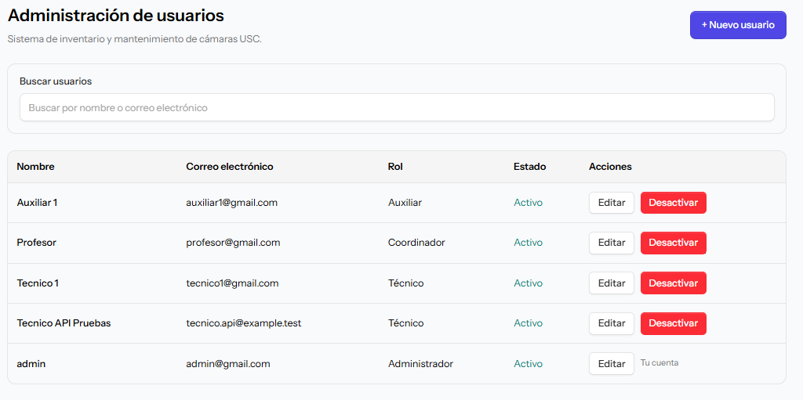

*Figura 15. Vista de administración de usuarios.*

## 12. Vincular mantenimiento correctivo con una incidencia (HU-12)

**Objetivo:** relacionar una intervención correctiva con una incidencia técnica pendiente, conservar el historial del trabajo y registrar si realmente se corrigió la avería.

### 12.1 Registrar la intervención desde la incidencia

1. Abre «Incidencias» e identifica una incidencia con estado técnico «Pendiente de corrección» vinculada a una cámara activa.
2. En el bloque de esa incidencia, selecciona «Registrar mantenimiento correctivo». Esta opción está sujeta a los permisos del usuario.
3. Comprueba que el formulario identifica la incidencia y la cámara correspondientes. El tipo de mantenimiento queda establecido como «Correctivo».
4. Completa «Fecha del mantenimiento», «Descripción de la intervención», «Responsable del mantenimiento» y «Resultado de la intervención» con información de la actuación real.
5. En «¿La intervención corrigió realmente la incidencia?», elige «Sí, el fallo quedó corregido» solo si lo has comprobado; en caso contrario, selecciona «No, la incidencia sigue pendiente».
6. Pulsa «Guardar mantenimiento» y comprueba el mensaje de registro. El sistema guarda la intervención asociada a la incidencia.

> **Resultado esperado:** El mantenimiento correctivo queda registrado y asociado a la incidencia seleccionada; el estado técnico se determina por la confirmación humana del resultado.

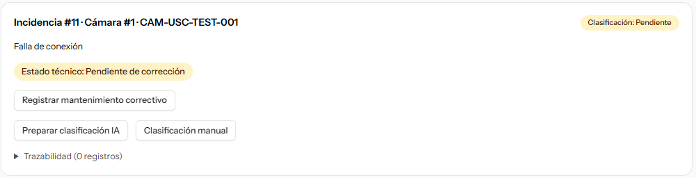

*Figura 16. Acción de mantenimiento correctivo en la incidencia.*

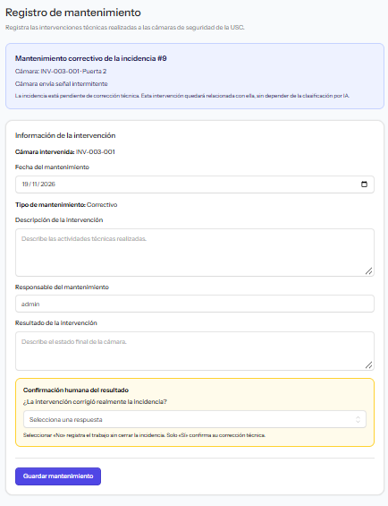

*Figura 17. Formulario de mantenimiento correctivo asociado.*

### 12.2 Comprobar estado técnico y trazabilidad

1. Regresa a «Incidencias» y localiza la intervención registrada. Si se confirmó «Sí», el estado técnico pasa a «Corregida»; si se eligió «No», permanece «Pendiente de corrección».
2. Entra en el «Historial de mantenimientos» de la cámara y consulta el mantenimiento correctivo con su incidencia vinculada y el resultado registrado.
3. Si el problema no se solucionó, documenta una nueva intervención correctiva cuando corresponda; no marques como corregida una falla pendiente.
4. Distingue el estado técnico de reparación del estado de revisión de la clasificación por IA: son independientes.

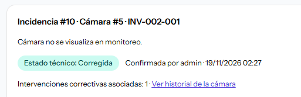

*Figura 18. Estado técnico de la incidencia tras la intervención.*

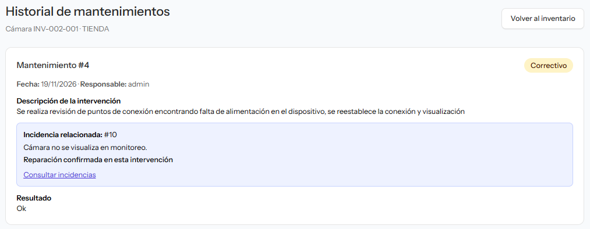

*Figura 19. Historial con mantenimiento e incidencia vinculados.*

## 13. Problemas frecuentes y seguridad

### 13.1 Solución de problemas

| Situación | Acción sugerida |
| --- | --- |
| No puedo iniciar sesión | Comprueba el usuario y la contraseña y consulta si tu cuenta está activa. |
| No veo «Registrar cámara» u otra opción | Es posible que tu rol no tenga permiso. Consulta con el administrador. |
| Número de serie duplicado | Verifica si ya existe otra cámara con ese número de serie; no fuerces un valor ficticio. |
| No aparece una cámara al registrar mantenimiento | Comprueba su existencia y si está retirada; pide verificación de permisos. |
| La IA no ofrece sugerencia | Usa «Clasificación manual» si está habilitada y notifica al responsable técnico. |
| No aparece «Registrar mantenimiento correctivo» desde la incidencia | HU-12 está desplegada. Comprueba que la incidencia siga pendiente de corrección, que la cámara esté activa y que tengas permisos. Si aún falta el botón, solicita revisión técnica. |
| No puedo eliminar una incidencia desde la pantalla | No existe un flujo de eliminación para usuarios documentado en esta interfaz. Solicita soporte; no manipules la base de datos. |
| La pantalla no responde o no carga | Recarga una vez, verifica conectividad y comunica el error sin difundir información sensible. |

### 13.2 Buenas prácticas

- Verifica siempre la cámara seleccionada antes de registrar una incidencia, retirar un equipo o guardar un mantenimiento.
- No confundas «Categoría confirmada» con «Avería reparada»: son decisiones y estados diferentes.
- Cierra sesión en equipos compartidos y reporta accesos o cambios inesperados.

## Referencias y verificación del sistema

La información se contrastó con los cambios documentados en GitHub hasta el 19 de noviembre de 2026 y el estado de Railway en producción. La HU-12 tiene confirmados el despliegue y la migración.

**Repositorio:** https://github.com/jecaicedotoro-source/gestion-mantenimiento-camaras

- [PR #16](https://github.com/jecaicedotoro-source/gestion-mantenimiento-camaras/pull/16): Registro de mantenimientos (HU-09).
- [PR #19](https://github.com/jecaicedotoro-source/gestion-mantenimiento-camaras/pull/19): Proveedor Groq alternativo desactivado por defecto.
- [PR #21](https://github.com/jecaicedotoro-source/gestion-mantenimiento-camaras/pull/21): Historial de mantenimientos por cámara (HU-10).
- [PR #22](https://github.com/jecaicedotoro-source/gestion-mantenimiento-camaras/pull/22): Clasificación preventiva/correctiva de mantenimientos (HU-11).
- [PR #23](https://github.com/jecaicedotoro-source/gestion-mantenimiento-camaras/pull/23): HU-12 fusionada; despliegue Railway SUCCESS y migración 2026_11_18_130000_link_maintenances_to_incidents ejecutada (19/11/2026).